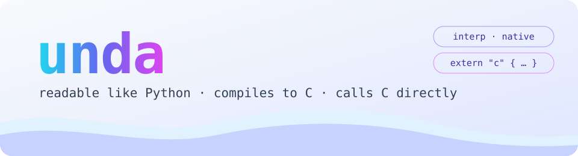
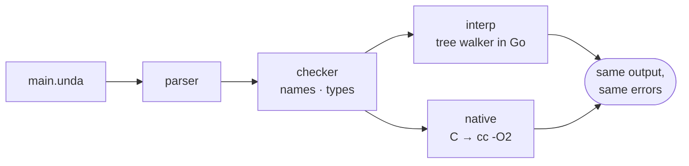

<div align="center">

<picture>
  <source media="(prefers-color-scheme: dark)" srcset="assets/banner-dark.svg">
  
</picture>

<br>

[](https://github.com/hhamaj/undalang/actions/workflows/ci.yml)
[](./LICENSE)
[](./go.mod)
[](#status-and-limitations)

**[Quick start](#quick-start)** · **[Technical overview](#technical-overview)** · **[Memory safety](#memory-safety)** · **[Performance](#performance)** · **[Language guide](#language-guide)** · **[Roadmap](./ROADMAP.md)**

</div>

Unda is a general-purpose language that reads like a script and grows into a systems language when you need it. Start with untyped code in the REPL, add types where they help, then compile the same program to a native executable through C and call C libraries directly.

<table>
<tr>
<th>main.unda</th>
<th>output</th>
</tr>
<tr>
<td>

```unda
import "strings" as strings

struct User {
    name: string
    age: int
}

fn parse_age(s: string) -> result {
    match try_int(s) {
        ok(n) if n >= 0 -> ok(n),
        _ -> err("not an age: " + strings.trim(s)),
    }
}

fn parse_user(line: string) -> result {
    match strings.split(line, ",") {
        [name, age] -> ok(User(strings.trim(name), parse_age(age)?)),
        _ -> err("expected name,age: " + line),
    }
}

for line in ["ada, 36", "linus, x", "grace"] {
    match parse_user(line) {
        ok(u) -> println("hello", u.name |> strings.upper, u),
        err(e) -> println("error:", e),
    }
}
```

</td>
<td>

```text
$ unda run main.unda
hello ADA User(name: ada, age: 36)
error: not an age: x
error: expected name,age: grace
```

The native executable prints the same:

```text
$ unda build main.unda -o app
$ ./app
```

</td>
</tr>
</table>

## Quick start

> [!TIP]
> You need Go 1.22 or newer. The native backend also needs a C compiler (`cc`, or set `$CC`).

```sh
git clone https://github.com/hhamaj/undalang
cd undalang
go build -o unda ./cmd/unda

./unda repl                                      # try it interactively
./unda run examples/phase1_data_pipeline.unda    # run with the interpreter
./unda check examples/phase1_data_pipeline.unda  # static checks only
./unda build examples/phase1_data_pipeline.unda -o app && ./app   # native executable
```

## Technical overview

| | |
|---|---|
| **Typing** | Dynamic, with optional annotations (`int`, `array[Point]`, `map[string, int]`, structs). `unda check` reports what it can prove before running; everything else is checked at runtime. Untyped and typed code mix freely. |
| **Execution** | Two backends behind one front end. `interp` is a tree-walking interpreter in Go: instant start, used by the REPL. `native` translates the program to C and compiles it with the system compiler (`cc -O2`). The test suite runs every program through both and compares stdout, stderr and exit code. |
| **Memory management** | Garbage collected. The interpreter uses Go's GC; native executables carry a conservative mark-and-sweep collector that scans the stack and registered roots. Manual memory exists only as `mem` buffers, for handing memory to C. |
| **Memory safety** | Safe for Unda code: no pointers, checked indexing, checked buffers, no use after free. The only unsafe surface is C interop (`extern`). [Details](#memory-safety). |
| **Values** | Bindings are immutable unless declared `let mut`. Arrays, maps and structs are values: assigning or updating gives a new value, other holders keep the old one. `mem` buffers are the one shared, mutable value. |
| **Numbers** | `int` is a 64-bit two's complement integer that wraps on overflow (`9223372036854775807 + 1` is the minimum int), `float` is a 64-bit IEEE double. `7 / 2` is `3`, `7.0 / 2` is `3.5`. `int`, `float` and `string` convert between them and from text. |
| **Strings** | Immutable, UTF-8, indexed and measured by character: `len("çay")` is 3. |
| **Errors** | Expected failures are values: `ok(v)` / `err(e)`, unwrapped with `match` or `?`. Bugs (type mismatches, bad arguments) stop the program with `file:line:col`, exit code 1, identically in both backends. |
| **C interop** | `extern` blocks declare C functions with C types (`i8`…`u64`, `f32`, `f64`, `bool`, `cstring`, `ptr`) and C-layout structs passed by value. Arguments are range-checked when converted. Native backend only. |
| **Concurrency** | None yet. Programs are single-threaded. |
| **Recursion** | Limited to 10000 nested calls, reported as `maximum call depth exceeded`. |
| **Platform** | Linux, tested in CI. Native builds need a C compiler with GNU C extensions (gcc or clang). |



## Memory safety

Code written in Unda can't corrupt memory. This is what each kind of memory bug does instead:

| Bug class | In Unda |
|---|---|
| Dangling pointers, use after free | Unda has no pointers to its own values, and values are copied, not aliased. Memory is reclaimed by the GC only when nothing can reach it. |
| Out-of-bounds index | `xs[10]` on a short array gives `nil`; nothing outside the array is read. |
| Buffer overflow | Every `mem.get_*` / `mem.set_*` is bounds checked: `offset 20 is out of range for a 16 byte buffer`. Values must fit the type (`set_i8` of 300 is an error). |
| Use of a freed buffer, double free | `mem.free` marks the buffer; any later use, including passing it to C, is a runtime error. |
| Integer overflow | Defined: wraps around, the same in both backends. Never undefined behavior. |
| Data races | Not possible, programs are single-threaded. |
| Uninitialized memory | Not observable. Bindings need a value, `mem.alloc` zeroes. |

> [!WARNING]
> **`extern` is the unsafe boundary.** Declaring a C function with the wrong signature is undefined behavior, as it is in C, and C code can do anything with a `ptr` or buffer it receives. Keep `extern` blocks small and in one place.

Known gaps:
- A `mem` buffer that is never passed to `mem.free` leaks its bytes; the collector frees the handle but not the C memory behind it.
- The native collector is conservative: an integer that happens to look like a pointer can keep dead memory alive. This can waste memory, it can't free live memory.

## Performance

Wall-clock time in milliseconds, best of several runs, including process start. Lower is better. All four print the same result.

| benchmark | C (`-O2`) | **Unda native** | Python 3.14 | Unda interp |
|---|---:|---:|---:|---:|
| `fib(32)`, recursive calls | 3.4 | **27** | 229 | 1854 |
| primes below 300000, nested loops | 21.5 | **26** | 1582 | 2741 |
| map, filter and reduce over 1M ints | 10.3 | **52** | 182 | 434 |
| 200000 updates to a 1000-key map | — | **5890** | 349 | 28213 |
| `hello` (startup) | 0.5 | **0.8** | 15.8 | 1.6 |

<sub>AMD Ryzen 5 5600, Linux, gcc 16.2, Go 1.26. Native times exclude compilation: `unda build` takes about 0.5 s, most of it compiling the C runtime. Peak memory for the map/filter/reduce run: C 20 MB, Unda native 47 MB, Python 65 MB, Unda interp 115 MB. The programs are in [`bench/`](./bench).</sub>

What the numbers say:
- **Loops over integers run close to C** (primes: 26 ms against 21.5). The generated C does integer arithmetic inline.
- **Function calls cost about 8x C.** Every value is a tagged 16-byte struct, and each call sets up a frame, records its source location and counts depth for the recursion limit. Still about 8x faster than Python.
- **Map updates are slow.** Maps are values, so `maps.set` copies the map: a loop that updates a 1000-key map is 17x slower than Python. This is the biggest performance gap today.
- **The interpreter is slower than CPython** on calls and loops. It is meant for the REPL and quick runs; `unda build` is the fast path.

Compiling typed functions to plain C types, cheaper calls and maps that don't copy on every update are the next steps, see the [roadmap](./ROADMAP.md).

## Status and limitations

Unda is experimental and pre-1.0: the language and standard library still change. Not there yet:
- concurrency, a package manager, a formatter (`unda fmt`) and editor support
- calling C from the interpreter (`extern` needs `unda build` or `unda run --native`)
- Windows and macOS are untested

## Language guide

The full reference, one section per topic. Click to expand.

<details>
<summary><b>Running, backends and diagnostics</b></summary>

### Run

```sh
go run ./cmd/unda repl
go run ./cmd/unda run examples/phase1_data_pipeline.unda          # interpreter
go run ./cmd/unda check examples/phase1_data_pipeline.unda        # static checks only
go run ./cmd/unda build examples/phase1_data_pipeline.unda -o app # native executable
go run ./cmd/unda run --native examples/phase1_data_pipeline.unda # build + run
```

`unda build` needs a C compiler (`cc`, or `$CC`). Pass `--emit-c out.c` to keep the generated C.

### Backends

Every program goes through the same front end (parser and checker), then one of two backends runs it. Pick one with `unda run --backend=interp|native` (`--native` is short for the second):

- `interp` walks the syntax tree. It starts instantly and runs code the checker would reject, which suits the REPL and quick experiments.
- `native` compiles to C and runs the executable, much faster, and it's the only one that can call C (`extern`).

Both give the same output, the same errors at the same places and the same exit codes; the test suite runs every program through both and compares.

### Checking and Diagnostics

`unda check` resolves every name and runs a conservative type check without executing the program. It reports undefined identifiers, assignments to immutable bindings, operator type mismatches between statically known values (`len(x) + "!"`), calls to non-functions, wrong argument counts for known functions and builtins, unknown module members, and invalid map keys or index types. Code whose types depend on runtime values (function parameters, `let mut` bindings) is accepted as is.

```text
main.unda:3:19: error: type mismatch: INTEGER + STRING
  3 | let n = len(name) + "!"
    |                   ^
```

Runtime errors carry the same location in both the interpreter and native executables:

```text
runtime error: main.unda:6:20: type mismatch: INTEGER + STRING
```

### Native Backend

`unda build` lowers the program to C and compiles it with the system C compiler. The native executable behaves like the interpreter: same output formatting, same error messages and locations, and the same standard library. The test suite enforces this by running every program through both backends and comparing stdout, stderr, and the exit code.

The generated code does integer arithmetic and comparisons inline and calls functions declared with `fn` directly, falling back to the general (and error-reporting) path only when it has to, so it runs well ahead of the interpreter: about 9x faster than Python 3.14 on recursive calls and 45x on integer loops in our measurements.

Native executables free unused memory with a conservative mark-and-sweep garbage collector. It runs once the program has allocated more than its live heap (at least 8 MiB); set `UNDA_GC_THRESHOLD=<bytes>` to change the minimum.

Current limitations:

- `time.format` is not available natively yet (`unda build` reports it at compile time).
- `process.args()` returns the executable's own arguments.
- Recursion is limited to 10000 nested calls in both backends.

</details>

<details>
<summary><b>Syntax, match and loops</b></summary>

### Current Syntax

Variables are immutable by default. Use `let mut` when a binding must be reassigned.

```unda
let name = "unda"
let mut count = 1
count = count + 1
```

Functions can be anonymous or named. Named functions are bindings in the current scope.

```unda
fn add(a, b) {
    return a + b
}

let double = fn(x) { return x * 2 }
```

Comments start with `//` and run to the end of the line.

`m.key` reads a string key from a map, like `m["key"]`; missing keys give `nil`.

Unda supports arrays, maps, indexing, `if`, and `match`. Strings are indexed by character: `len("çay")` is 3 and `"çay"[0]` is `"ç"`.

```unda
let xs = [1, 2, 3]
let data = {"name": "unda", "count": len(xs)}

match data["count"] {
    0 -> "empty",
    3 -> data["name"],
    _ -> "other",
}
```

`match` arms take patterns. A bare name binds the value, `[first, ..rest]` destructures arrays, `{"key": value}` destructures maps (extra keys are allowed), and `if` adds a guard. Literals compare by value; to compare against a variable, use a guard such as `x if x == limit`.

```unda
fn describe(v) {
    match v {
        [] -> "empty",
        [first, ..rest] -> "starts with " + type(first),
        {"name": name} -> name,
        n if type(n) == "integer" && n < 0 -> "negative",
        _ -> "other",
    }
}
```

### Loops

`while` repeats while its condition is truthy. `for` iterates arrays (elements), maps (keys in sorted order) and strings (characters); with two names it also binds the index or key. `break` and `continue` work in both. Each iteration gets fresh bindings, so closures created in a loop capture that iteration's values.

```unda
let mut i = 0
while i < 3 {
    i = i + 1
}

for name in ["ada", "bo"] { println(name) }
for i, name in ["ada", "bo"] { println(i, name) }
for key, value in {"a": 1, "b": 2} {
    if value == 2 { break }
    println(key, value)
}
```

The pipeline operator calls the expression on the right with the left value inserted as the first argument. If the right side is a bare function, it is called with one argument.

```unda
import "strings" as strings
import "arrays" as arrays

fn shout(s) { return s |> strings.upper }

"unda,go"
    |> strings.split(",")
    |> arrays.map(shout)
    |> strings.join("-")
    |> println
```

</details>

<details>
<summary><b>Type annotations</b></summary>

### Type Annotations

Types are optional. Bindings, parameters and return values can carry one, untyped code works exactly as before.

```unda
let mut count: int = 0

fn add(a: int, b: int) -> int {
    return a + b
}

let label = fn(name: string, value) -> string { name + ": " + type(value) }
```

The types are `int`, `float`, `number` (int or float), `string`, `bool`, `nil`, `array`, `map`, `fn` (functions and builtins), `module`, `result`, `ptr`, `buffer`, `any` and the name of any struct.

Arrays and maps can say what they hold: `array[int]`, `map[string, int]`, `array[Point]`, `map[string, array[float]]`. Map keys can be `int`, `string`, `bool`, `nil` or `any`. Checking one of these at runtime looks at every element, so it costs time proportional to the collection; a mismatch names the first offender:

```text
runtime error: main.unda:4:1: type mismatch: scores expects map[string, int], got MAP (value at key "bob" is STRING)
```

`unda check` reports mismatches it can prove without running the program, and typed bindings and parameters give it more to work with:

```text
main.unda:1:28: error: type mismatch: f returns string, got INTEGER
  1 | fn f(a: int) -> string { a + 1 }
    |                            ^
```

Everything else is checked at runtime, in both backends: `let` and assignments to typed bindings, arguments to typed parameters, and the value a typed function returns (whether through `return` or by falling off the end of its body).

```text
runtime error: main.unda:3:1: type mismatch: parameter a expects int, got STRING
```

A name redeclared in the same scope has to keep its type.

</details>

<details>
<summary><b>Errors as values</b></summary>

### Errors as Values

Errors you expect are values: `ok(value)` or `err(reason)`. `match` takes them apart, and `?` after an expression unwraps an `ok` or returns the `err` from the current function right away.

```unda
fn parse_port(s: string) -> result {
    match s {
        "80" -> ok(80),
        _ -> err("not a port: " + s),
    }
}

fn parse_addr(host: string, port: string) -> result {
    let p = parse_port(port)?
    ok({"host": host, "port": p})
}

match parse_addr("localhost", "x") {
    ok(a) -> println(a.host, a.port),
    err(e) -> println("error:", e),
}
```

Builtins that can fail because of the outside world (a missing file, broken JSON, a command exiting non-zero) have a `try_` twin that returns `ok(value)` or `err(message)` instead of stopping the program. Passing the wrong kind of argument is still a runtime error, since that's a bug in the program rather than something to handle.

```unda
import "json" as json

fn load_config(path: string) -> result {
    let text = try_read_file(path)?
    json.try_parse(text)
}
```

`?` applies to the expression right before it, so `f(x)? + 1` unwraps `f(x)` but `x |> f?` unwraps `f`; write `(x |> f)?` to unwrap a pipeline. Using `?` outside a function, where there is nothing to return to, makes an `err` a runtime error (`unhandled err(...)`). A function with a return type other than `result` or `any` can't use `?`, and `unda check` says so.

</details>

<details>
<summary><b>Structs</b></summary>

### Structs

A struct groups named fields. Field types are optional, like everywhere else. Build a value by calling the struct with the fields in order, or by name:

```unda
struct Point {
    x: number
    y: number
}

let p = Point(1, 2)
let q = Point(y: 4, x: 3)
println(p.x, q)             // 1 Point(x: 3, y: 4)

fn dist2(a: Point, b: Point) -> number {
    (a.x - b.x) * (a.x - b.x) + (a.y - b.y) * (a.y - b.y)
}
```

Struct names start with an uppercase letter and work as types (`p: Point`). Structs are values: `r.x = 5` on a `let mut` binding gives `r` a copy with that field changed, and anything else holding the old value keeps it. The same works for string keys of maps (`cfg.db.port = 5432`). Two struct values are equal when they come from the same declaration and their fields are equal.

</details>

<details>
<summary><b>Calling C and buffers</b></summary>

### Calling C

`extern` declares functions from a C library with their C types. After that they are called like any builtin:

```unda
extern "m" {
    fn sqrt(x: f64) -> f64
    fn pow(base: f64, exp: f64) -> f64
}

extern "./libgeo.so" {
    fn area(w: i32, h: i32) -> i64
    fn reset()
}

println(sqrt(pow(3, 2) + pow(4, 2)), area(3, 4))
```

The C types are `i8`, `i16`, `i32`, `i64`, `u8`, `u16`, `u32`, `u64`, `f32`, `f64`, `bool`, `cstring` (a NUL-terminated `char *`; a NULL result comes back as `nil`) and `ptr`. Leave out the return type for `void`.

`ptr` is any other pointer, like a `FILE *` or a handle a library gives out. Unda code can only hold it, compare it and pass it back to C; it can't read through it or do arithmetic on it. NULL comes back as `nil`, and `nil` passed as a `ptr` is NULL. `ptr` also works as an ordinary type annotation.

```unda
extern "c" {
    fn fopen(path: cstring, mode: cstring) -> ptr
    fn fputs(s: cstring, f: ptr) -> i32
    fn fclose(f: ptr) -> i32
}

let f = fopen("/tmp/out.txt", "w")
if f == nil { println("could not open") } else {
    fputs("hello from unda\n", f)
    fclose(f)
}
```

Arguments are converted when the call happens and must fit: an int that doesn't fit an `i32` or a negative int for a `u64` is a runtime error, not a silent truncation.

A struct declared inside an extern block gets a C layout, fields in order with C types, and can go to and come back from C by value. On the Unda side it's an ordinary struct (an `i32` field takes an int, an `f64` field a number):

```unda
extern "./libgeo.so" {
    struct Vec2 { x: f64, y: f64 }
    struct Box { min: Vec2, max: Vec2, name: cstring, id: i32 }
    fn vec_scale(v: Vec2, by: f64) -> Vec2
    fn box_area(b: Box) -> f64
}

println(vec_scale(Vec2(1, 2), 3))    // Vec2(x: 3, y: 6)
```

Only structs declared this way can cross into C; `cstring` and `ptr` fields may be `nil` (NULL).

The library is `"c"` for libc, a name like `"m"` or `"sqlite3"` to link `-lm` / `-lsqlite3`, or a path to a `.so` or `.a` file (relative to the source file). Shared libraries given by path are found again at runtime through an rpath.

#### Buffers

Some C functions want memory to fill in, like `gettimeofday` filling a `struct timeval`. The `mem` module hands out buffers of C memory for that. A buffer passes wherever an extern function takes a `ptr`, and its bytes are read and written at byte offsets:

```unda
import "mem" as mem

extern "c" { fn gettimeofday(tv: ptr, tz: ptr) -> i32 }

let tv = mem.alloc(16)               // zeroed, freed only by mem.free
gettimeofday(tv, nil)
println(mem.get_i64(tv, 0))          // seconds
mem.free(tv)
```

There are `get_` and `set_` functions for `i8` through `u64`, `f32`, `f64` and `cstring`, plus `alloc`, `free` and `size`. Every access is bounds checked, values have to fit the type (`set_i8` of 300 is an error) and using a buffer after `mem.free` is a runtime error, in Unda code and when handing it to C. Numbers use the machine's byte order. What C does with the pointer is up to C.

Buffers are the one thing in Unda that changes in place: two names for the same buffer see the same bytes. That's the point of them, they stand for memory that C shares. The `mem` module works in both backends; only passing buffers to C needs the native one.

Extern functions only work in the native backend (`unda build`, `unda run --native`); the interpreter stops at the `extern` block with an error. Declaring a function with the wrong C signature is undefined behavior, same as in C.

</details>

<details>
<summary><b>Modules and builtins</b></summary>

### Modules

Use `import "module" as name` for standard modules or local `.unda` files. Local imports are resolved relative to the file being run; the `.unda` suffix is optional.

```unda
import "json" as json
import "stats" as stats

println(json.stringify(stats.describe([1, 2, 3])))
```

Imported Unda files expose their top-level bindings through member access:

```unda
import "stats" as stats
stats.sum([1, 2, 3])
```

### Builtins

Global builtins:

- `print(...)`, `println(...)`
- `len(value)` for strings (characters), arrays, and maps
- `type(value)`
- `ok(value)`, `err(reason)`
- `read_file(path)`, `write_file(path, content)`, `append_file(path, content)`
- `try_read_file`, `try_write_file`, `try_append_file`: same arguments, return a result
- `int(v)`, `float(v)`: convert an int, float or string (`int("36")`, `int(3.9)` is 3, `float("2.5")`); a string that isn't a number stops the program
- `try_int(v)`, `try_float(v)`: same, but return `ok(n)` or `err(message)`
- `string(v)`: the text `println` would print for `v`

Standard modules:

- `strings`: `split`, `join`, `upper`, `lower`, `trim`, `replace`, `contains`, `has_prefix`, `has_suffix`
- `arrays`: `append`, `first`, `last`, `map`, `filter`, `reduce`, `range`, `reverse`, `slice`, `join`
- `maps`: `get`, `has`, `set`, `merge`, `keys`, `values`
- `json`: `parse`, `try_parse`, `stringify`
- `math`: `abs`, `ceil`, `floor`, `max`, `min`, `pow`, `round`, `sqrt`
- `time`: `now`, `unix`, `format`
- `process`: `args`, `env`, `run`, `try_run`
- `mem`: `alloc`, `free`, `size`, `get_`/`set_` for `i8`…`u64`, `f32`, `f64`, `cstring`
- `bits`: `and`, `or`, `xor`, `not`, `shl`, `shr` (keeps the sign), `ushr` (fills with zeros), `count` (set bits), all on the 64 bits of an int
- `os`: `exit`, `exists`, `is_dir`, `list_dir`, `mkdir`, `remove`, `cwd`, `getpid`, plus `try_list_dir`, `try_mkdir` and `try_remove`
- `shell`: `run`, `try_run`

</details>

## Examples

- `examples/phase0.unda`: foundation syntax
- `examples/mutability.unda`: mutable and immutable bindings
- `examples/phase1_data_pipeline.unda`: arrays, maps, match, pipeline, JSON
- `examples/phase1_import_fileio.unda`: local module import and file I/O
- `examples/phase3_types.unda`: type annotations
- `examples/phase3_results.unda`: `ok`/`err` results and `?`
- `examples/phase4_structs.unda`: structs
- `examples/phase4_ffi.unda`: calling C functions (native only)
- `examples/phase4_system.unda`: `bits` and `os`

## License

GPL-3.0, see [LICENSE](./LICENSE).
